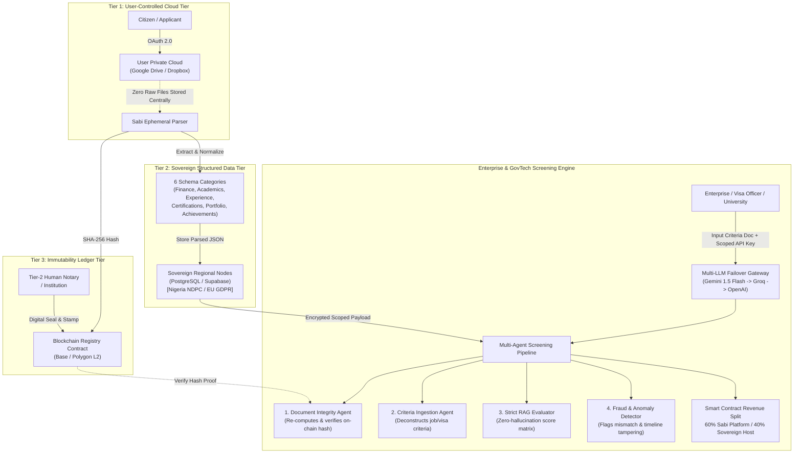
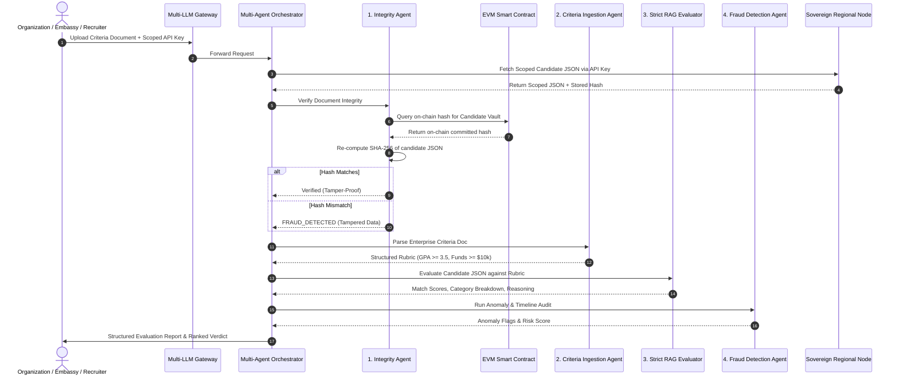
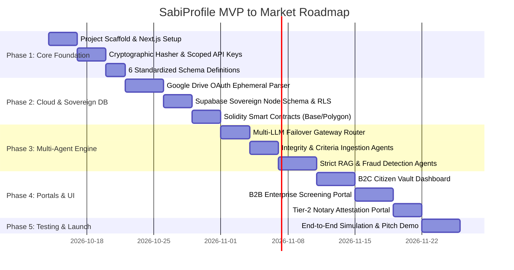

# SABIPROFILE: MASTER IMPLEMENTATION & EXECUTION PLAN
> **Architectural Blueprint, Multi-Agent Engine, Smart Contract Infrastructure, and Phased Roadmap**  
> *Target Verticals:* Immigration & Border Agencies, Higher Education & Admissions, Labour & Enterprise Hiring.  
> *Sovereignty Model:* Zero Raw Central Storage | Regional Database Nodes (NDPC/GDPR) | Low-Cost Blockchain Ledger.

---

## 1. Executive Mission & System Architecture



---

## 2. Low-Budget MVP Technology Stack (< $10/Month Beta Run)

To guarantee high scalability, enterprise security, and immediate feasibility for early beta testers on a bootstrap budget:

| Functional Component | Selected Technology | Budget Strategy / Tier | Why Chosen |
| :--- | :--- | :--- | :--- |
| **Frontend & API Gateway** | **Next.js 14/15 (App Router, TypeScript)** | Vercel Free / Cloudflare Pages ($0) | Unified full-stack, rapid server actions, high performance, edge execution. |
| **UI Components & Styling** | **Tailwind CSS + shadcn/ui + Lucide** | Open Source ($0) | Enterprise aesthetic, accessible, fast prototyping, zero licensing cost. |
| **Database & Sovereign Nodes** | **Supabase (PostgreSQL 16 + RLS)** | Free Tier ($0 - 500MB DB, 50k MAU) | Built-in Row Level Security, instant REST/GraphQL, native regional deployment for sovereign compliance. |
| **Cloud Storage Connector** | **Google Drive API (OAuth 2.0)** | Google Cloud Console Free Tier ($0) | Direct document streaming. **Zero gigabytes stored on Sabi servers = zero cloud storage bill.** |
| **Ephemeral Parsing & OCR** | **`pdf-parse` + Tesseract.js / Gemini Flash** | Free Tier ($0) | Fast parsing on serverless functions with zero external OCR subscription needed. |
| **Blockchain Immutability** | **Base Sepolia / Polygon Amoy (EVM L2)** | Testnet ($0.00) / Mainnet (<$0.01/tx) | Fast block time (2s), sub-cent fees, Ethereum standard smart contracts, audited OpenZeppelin primitives. |
| **Multi-LLM Failover Engine** | **Gemini 1.5 Flash + Groq (LLaMA 3.3) + gpt-4o-mini** | Free / Micro-cents (<$5/mo) | Google AI Studio has generous free tier for Gemini Flash; Groq provides free tier with ultra-fast TPS. |
| **Cryptographic Security** | **Node.js `crypto` / Web Crypto (SHA-256 + HMAC)** | Built-in ($0) | Unbreakable deterministic hashing and time-scoped API key issuance. |

---

## 3. Core Functional Modules & Schemas

### 3.1 The 6 Vault Categories (Standardized JSON Schemas)
Every citizen's synced credentials will be parsed into strictly typed schemas:
1. **`finance`**:
   - `balances`: `{ currency: string, liquidBalance: number, average3MonthBalance: number, timestamp: string }`
   - `transactions`: Array of standardized proof records.
   - `taxCompliance`: Tax clearance certificate reference, issuer, validity period.
2. **`portfolio`**:
   - `bio`: Professional summary, headline, contact handles, personal links.
   - `links`: GitHub, LinkedIn, personal domain, research profiles.
3. **`certifications`**:
   - `licenses`: Title, issuing body, license ID, issue date, expiry date, verification URL.
4. **`academics`**:
   - `degrees`: Institution name, degree type (BSc, MSc, PhD), major/field, GPA / Class of Degree, graduation date.
   - `transcripts`: Detailed course codes, credits, grades.
5. **`experience`**:
   - `history`: Company, title, tenure (`startDate`, `endDate`), verified reference contacts, project summaries, responsibilities.
6. **`achievements`**:
   - `awards`: Title, issuing organization, year, description, grant values, competition standings.

### 3.2 Two-Tier Document Verification Engine
- **Tier 1 (Standard Hashed):**
  - Workflow: User syncs file via Google Drive. Ephemeral parser reads binary stream, calculates `SHA256(fileContent)`, writes record to regional database, and commits hash to smart contract.
  - Level of trust: **Authentic & Immutable Existence** (proves the document existed at timestamp $T$ and has not been altered).
- **Tier 2 (Authenticated / Legalized):**
  - Workflow: Academic transcripts, sworn affidavits, and diplomas require an authorized entity (Notary Public, Embassy Agent, or University Registrar) to inspect the physical or original document, affix their cryptographic signature / notary seal, and execute a multi-signature transaction binding their credential ID and the file hash on-chain.
  - Level of trust: **Legally Binding Attestation**.

### 3.3 Scoped Cryptographic API Key Generator
Format of generated candidate keys:
```
sbk_live_v1_<payload_base64url>.<signature_hmac_or_ed25519>
```
The payload contains:
```json
{
  "vaultId": "usr_99812739",
  "allowedScopes": ["academics", "finance"],
  "expiresAt": 1792400000,
  "maxQueries": 5,
  "queryCount": 0,
  "assignedTo": "org_visa_uk_gov",
  "issuedAt": 1791795200
}
```
When an enterprise queries the SabiProfile gateway with this key:
1. Signature is validated against Sabi's signing key.
2. Expiration and query count checks run instantly.
3. Gateway fetches ONLY the allowed category scopes (`academics` and `finance`) from the candidate's sovereign node.
4. The remaining categories (`experience`, `portfolio`, `certifications`, `achievements`) are completely redacted.

---

## 4. Multi-Agent Enterprise Screening Pipeline



---

## 5. Smart Contract Architecture (EVM L2)

### 5.1 `SabiProfileRegistry.sol`
- **Purpose:** On-chain tamper-proof hash ledger.
- **Key Functions:**
  - `commitHash(bytes32 vaultId, bytes32 categoryHash, uint8 tier, bytes notarySeal)`: Records the document hash on-chain with block timestamp and verification tier.
  - `verifyHash(bytes32 vaultId, bytes32 categoryHash)`: View function returning boolean status, timestamp, and tier level.
  - `registerNotary(address notaryAddress, string jurisdiction)`: Admin function to license accredited notaries.

### 5.2 `SabiRevenueSplitter.sol`
- **Purpose:** GovTech 60/40 micro-transaction revenue split.
- **Workflow:**
  - Enterprise pays query fee (e.g., $1.00 or $5.00 in USDC / native token).
  - Contract splits incoming payment:
    - **60%** transferred to Platform Treasury address.
    - **40%** transferred directly to the Sovereign Regional Node Host address (Government / Regional Sovereign Host).
  - Completely auditable, transparent, and removes bureaucratic friction.

---

## 6. Phased Implementation Roadmap



### Detailed Phase Breakdown:
- **Phase 1: Foundation & Cryptography (Days 1–5)**
  - Initialize Next.js 14/15, Tailwind, TypeScript, project scaffolding.
  - Implement SHA-256 deterministic hashing module.
  - Implement Scoped API Key generator & verifier with HMAC/Ed25519 signing.
  - Create Zod validation schemas for the 6 Vault Categories.

- **Phase 2: Storage Connectors & Sovereign Nodes (Days 6–12)**
  - Google Drive OAuth connector (ephemeral file download -> stream parse -> memory discard).
  - PDF & document text extraction pipeline.
  - Supabase database migration scripts with regional tenant flags and strict Row Level Security.
  - Deploy `SabiProfileRegistry.sol` and `SabiRevenueSplitter.sol` to Base Sepolia testnet.

- **Phase 3: Multi-Agent Screening Engine & LLM Gateway (Days 13–18)**
  - Multi-LLM failover router (Gemini 1.5 Flash primary -> Groq LLaMA 3 fallback -> OpenAI mini tertiary).
  - Integrity Agent (blockchain cross-verification).
  - Criteria Ingestion Agent (converts job specs/visa requirements into structured evaluation rubrics).
  - Strict RAG Evaluator (candidate data vs rubric matching without hallucinations).
  - Fraud & Anomaly Detector (checks dates, gaps, un-notarized legal docs, inconsistent balances).

- **Phase 4: User & Enterprise Portals (Days 19–25)**
  - **Citizen Vault:** Category browsing, Google Drive sync button, Scoped Key generation modal (choose scopes, set expiration, copy key).
  - **Enterprise Screening Portal:** Input candidate API key, upload requirements document (PDF/text), trigger multi-agent pipeline, view instant ranking, hash verification badge, and match breakdown.
  - **Notary Portal:** Attestation queue for Tier-2 legal documents with signature stamping.

- **Phase 5: Compliance Audit, Beta Hardening, and Pitch Validation (Days 26–30)**
  - Validate against the 2-minute pitch script scenarios.
  - Rehearse technical defenses (GDPR residency proof, blockchain anti-tamper demonstration, LLM failover simulation).
  - Onboard early beta testers across recruitment and university admissions.

---

## 7. Security, Compliance, and Risk Safeguards

1. **Zero Raw File Storage Guarantee:**
   - Raw binary buffers are processed in-memory only and immediately garbage collected.
   - SabiProfile databases store only structured parsed JSON.
2. **Data Residency Compliance (GDPR & NDPC):**
   - User profile metadata includes `residenceCountry` and `citizenship`.
   - Database connection pools dynamically route read/write operations to the corresponding regional PostgreSQL node.
3. **Cryptographic Anti-Tamper Verification:**
   - If a malicious internal administrator edits candidate JSON directly in the database (e.g. changing GPA from 2.5 to 3.9), the SHA-256 hash computed at query time will fail the on-chain registry check, instantly triggering `FRAUD_DETECTED`.
4. **LLM Hallucination Prevention:**
   - LLMs receive strict system prompts: they operate strictly as deterministic JSON evaluators against provided facts.
   - Outputs must cite specific JSON fields; any assertion not grounded in the verified JSON causes prompt rejection.
5. **Failover Gateway Resiliency:**
   - If Google Gemini returns HTTP 429/500, the gateway seamlessly fails over to Groq in < 300ms without user interruption.

