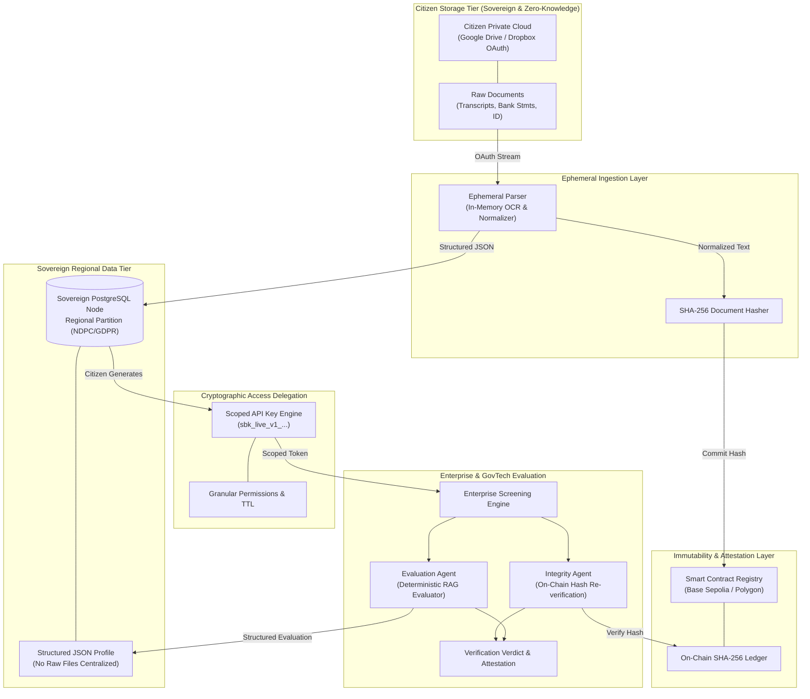
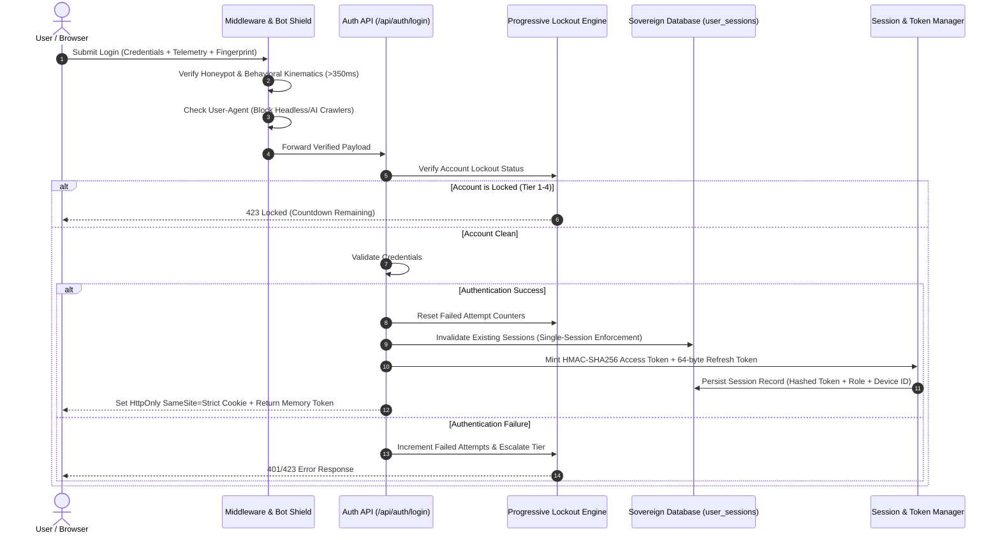

# Sabi Vault: Sovereign Data Infrastructure & Decentralized Identity Platform

<div align="center">


[](LICENSE)
[](https://nextjs.org)
[](https://sabivault.org)
[](https://ndpc.gov.ng)

**Developed and Maintained by Sabi AI Technologies Ltd**  
*Empowering Citizens, Enterprises, and Sovereign Governments with Verifiable, Decentralized Trust.*

[Overview](#-overview) • [Core Pillars](#-core-architectural-invariants) • [Key Features](#-key-features) • [System Flow & Architecture](#-system-flow--architecture) • [Tech Stack](#-technologies-used) • [File Structure](#-project-file-structure) • [Installation & Setup](#-installation--quickstart) • [Security & Compliance](#-security--compliance-suite) • [Corporate & Legal](#-corporate-governance--sabi-ai-technologies-ltd)

---

</div>

## 🌐 Overview

**Sabi Vault** is a mission-critical sovereign data infrastructure, programmable credential attestation engine, and decentralized identity platform engineered to solve the multi-billion-dollar trust deficit across three foundational pillars of the global economy:

1. **Immigration & Border Security:** Visa verification, proof of funds attestation, and authenticated cross-border legal records without physical document handling.
2. **Education & Academic Mobility:** Instant academic credential verification, tamper-proof transcript evaluations, and fraud-free global student screening.
3. **Labour & Enterprise Hiring:** Real-time qualification audits, authenticated employment histories, and programmable candidate screening without resume manipulation.

Traditional verification workflows rely on vulnerable physical PDFs, forged credentials, siloed government portals, and manual notarization pipelines. **Sabi Vault fundamentally re-architects this model**: physical documents remain under user sovereignty in private cloud storage, structured data resides in sovereign regional database nodes, and immutable cryptographic hashes are committed to decentralized blockchain ledgers. 

Multi-agent AI screening pipelines evaluate cryptographically scoped API keys against enterprise criteria without ever accessing or centralizing physical documents.

---

## 🏛️ Core Architectural Invariants

Every subsystem in Sabi Vault adheres strictly to four non-negotiable architectural mandates:

```
┌─────────────────────────────────────────────────────────────────────────────┐
│                        SABI VAULT INVARIANT LEDGER                          │
├───────────────────────────────┬─────────────────────────────────────────────┤
│ 1. Zero Raw Document          │ Physical documents NEVER touch Sabi Vault   │
│    Centralization             │ servers. Files stay in user Google Drive /  │
│                               │ Dropbox / OneDrive via secure OAuth 2.0.    │
├───────────────────────────────┼─────────────────────────────────────────────┤
│ 2. Sovereign Regional Nodes   │ Structured JSON schemas are strictly hosted │
│    (Data Residency)           │ in regionally isolated PostgreSQL / Supabase│
│                               │ instances (e.g., NDPC Nigeria, GDPR EU).    │
├───────────────────────────────┼─────────────────────────────────────────────┤
│ 3. Blockchain Verification    │ Every credential is deterministically hashed│
│    Layer                      │ (SHA-256) and verified against on-chain     │
│                               │ smart contracts (Base Sepolia / Polygon).   │
├───────────────────────────────┼─────────────────────────────────────────────┤
│ 4. Deterministic AI Screening │ Zero hallucinations. AI evaluation agents   │
│    (Strict RAG Evaluator)     │ operate purely as deterministic evaluators  │
│                               │ matching verified JSON against criteria.    │
└───────────────────────────────┴─────────────────────────────────────────────┘
```

---

## ⚡ Key Features

### 1. 🛡️ Citizen Vault (Self-Sovereign Identity)
* **Ephemeral Document Parser:** OCR and parse resumes, transcripts, and financial statements directly into normalized JSON in memory. Raw documents are never retained.
* **Programmable Scoped API Keys (`sbk_live_v1_...`):** Issue time-bound, permission-scoped cryptographic tokens granting third parties access strictly to necessary credentials (e.g., verifying degree completion without revealing grades or national identity numbers).
* **Instant One-Click Revocation:** Citizens retain complete ownership and can terminate third-party access immediately.
* **Full Transparency Audit Log:** Immutable activity ledger tracking every query, screen, or verification against the citizen's vault.

### 2. 🏛️ Sovereign Government & Border Control Hub
* **Automated Immigration & Visa Attestation:** Instant verification of sponsor proof of funds, police clearance, and academic prerequisites for border control agencies.
* **60/40 GovTech Sovereign Split:** Native programmatic revenue sharing automating a 60% platform / 40% sovereign treasury split on every commercial verification fee.
* **Real-Time Compliance Telemetry:** Sovereign dashboards providing anonymized border mobility metrics, fraud mitigation rates, and regional disbursement trends.

### 3. 🏢 Enterprise Multi-Agent AI Screening Studio
* **Dynamic Qualification Criteria Engine:** Define structured hiring, admissions, or compliance criteria with weighted scoring rules.
* **Deterministic Multi-Agent Pipeline:**
  * **Integrity Agent:** Verifies document SHA-256 hashes against on-chain smart contract registries.
  * **Evaluation Agent:** Evaluates candidate structured qualifications against vacancy requirements using zero-hallucination deterministic RAG.
* **Batch Verification APIs:** Concurrently evaluate hundreds of candidate vaults against position profiles via RESTful M2M endpoints.

### 4. 🔑 Machine-to-Machine (M2M) Dual-Key Developer Infrastructure
* **Organization API Keys (`X-Sabi-Org-Key`):** For enterprises, universities, and background check agencies to integrate automated candidate audits into existing ATS/HRIS pipelines.
* **Super Admin Control Plane (`X-Sabi-Admin-Key`):** Master configuration engine with dynamic AES-256-GCM encrypted secrets vault, real-time telemetry, and organization lifecycle management.
* **Real-Time Webhooks:** Instant event callbacks for verification status changes, dispute resolutions, and ledger confirmations.

### 5. 🔒 Enterprise-Grade Security Suite
* **Single-Session Policy (1 Device/Browser per User):** Prevents account sharing and credential hijacking. Authenticating on a new device automatically invalidates existing active sessions.
* **4-Tier Progressive Account Lockout:**
  * **Tier 1 (3 failed attempts):** 60-second cooldown.
  * **Tier 2 (6 failed attempts):** 1-hour cooldown.
  * **Tier 3 (9 failed attempts):** 24-hour cooldown.
  * **Tier 4 (12 failed attempts):** Permanent lockout requiring administrative support review.
* **Dual-Token Architecture & Silent Refresh:**
  * Refresh Token: 64-byte cryptographically secure random token hashed with SHA-256 in the database and delivered exclusively via an `HttpOnly`, `SameSite=Strict`, `Secure` cookie.
  * Access Token: 15-minute short-lived HMAC-SHA256 tamper-proof token stored strictly in client memory. Silent background rotation prevents session interruption.
  * 30-Day Absolute Expiry: Mandatory full re-authentication ceiling preventing infinite token rotation attacks.
* **Multi-Factor Device Fingerprinting:** Client-side hardware telemetry combining WebGL GPU vendor, Canvas 2D geometric signature, screen specs, CPU architecture, timezone, and persistent device identification.
* **Bot Defense & Anti-Scraper Shield:** Invisible honeypot traps, human behavioral telemetry verification (keystroke cadence, mouse kinematics, superhuman submission detection < 350ms), and automated rejection of AI crawlers (GPTBot, Claude-Web, Bytespider, Headless Chrome).
* **Strict Enterprise HTTP Headers:** Content Security Policy (CSP), `X-Robots-Tag: noindex, nofollow`, `X-Frame-Options: DENY`, `X-Content-Type-Options: nosniff`.

### 6. ✨ Apple Liquid Glass Design System
* **Curated Palette:** Pure White (`#ffffff`), Slate Dark (`#0f172a`), and Sabi Emerald (`#059669`).
* **Visual Polish:** Liquid Glass optical refraction (`liquid-glass-js`), animated Lucide vector icons, interactive GovTech ROI calculators, and spatial scroll storytelling.

---

## 🔄 System Flow & Architecture

### High-Level Architecture Data Flow



### Security & Authentication Flow



---

## 🛠️ Technologies Used

### Frontend & Client Tier
* **Framework:** Next.js 14.2 (App Router architecture with React Server Components)
* **Language:** TypeScript 5.x (Strict type safety across models and APIs)
* **Styling & UI:** Tailwind CSS, PostCSS, Lucide React (vector motion icons)
* **Design Engineering:** Custom Apple Liquid Glass optical shader library (`liquid-glass-js`), Framer Motion

### Backend & Core Services
* **Runtime:** Node.js (v18+ / v20+ / v24+) with hybrid Next.js Edge Middleware
* **API Architecture:** RESTful micro-routes, M2M webhook delivery, Server-Sent Events (SSE)
* **Document Processing:** Ephemeral memory-only parser with PDF text extraction and tabular normalizer

### Database & Regional Sovereignty
* **Primary Database:** PostgreSQL 15+ / Supabase Regional Sovereign Nodes
* **Security & Isolation:** Row-Level Security (RLS) policies, schema partitioning for NDPC (Nigeria) and GDPR (EU) compliance
* **Session Storage:** Dual-layer hybrid architecture (PostgreSQL `user_sessions` with in-memory resilient fallback)

### Cryptography & Blockchain
* **Hashing & Signatures:** Native Node.js `crypto` (SHA-256 cryptographic digests, HMAC-SHA256 token minting, `timingSafeEqual` anti-timing comparison)
* **Symmetric Encryption:** AES-256-GCM for platform secrets and credentials at rest
* **Blockchain Networks:** Base Sepolia Testnet, Polygon PoS / Amoy Testnet
* **Web3 Integration:** `ethers.js` v6, automated RPC fallback client with smart contract hash registry

### Artificial Intelligence & Multi-Agent Engine
* **Primary LLM:** Google Gemini 1.5 Flash (high-concurrency, low-latency qualification evaluation)
* **Fallback LLM:** Groq LLaMA 3 70B (sub-second high-throughput evaluator)
* **RAG Pipeline:** Strict deterministic matching against structured schema values (anti-hallucination enforced)

---

## 📁 Project File Structure

```
sabi-vault/
├── .agents/                        # Specialized agent capabilities and skills
├── .windsurf/                      # IDE rules, conventions, and agent memories
├── public/                         # Static assets (favicons, icons, vectors)
├── scripts/                        # Administrative CLI scripts (user promotion, etc.)
│   └── promote_super_admin.mjs    # CLI tool to promote users to Super Admin
├── src/
│   ├── agents/                     # Multi-agent AI screening pipeline
│   │   ├── evaluation_agent.ts     # Deterministic RAG candidate evaluator
│   │   ├── integrity_agent.ts      # Blockchain hash verification agent
│   │   └── gateway/
│   │       └── llm_gateway.ts      # Resilient Gemini / Groq router with fallback
│   ├── app/                        # Next.js 14 App Router
│   │   ├── (marketing)/            # Public marketing routes
│   │   │   ├── about/              # About Sabi Vault & Corporate mission
│   │   │   ├── blog/               # Architectural & engineering articles
│   │   │   ├── contact/            # Enterprise inquiry form
│   │   │   ├── docs/               # Developer documentation & API quickstart
│   │   │   ├── enterprise/         # Enterprise Screening Studio landing
│   │   │   ├── government/         # Sovereign GovTech & Border Control landing
│   │   │   └── legal/              # Privacy Policy (NDPC/GDPR) & Terms of Service
│   │   ├── api/                    # API endpoints
│   │   │   ├── auth/               # Enterprise Security Suite routes
│   │   │   │   ├── login/          # Progressive lockout, fingerprint, cookie issuance
│   │   │   │   ├── logout/         # Session invalidation & cookie clearance
│   │   │   │   ├── refresh/        # Silent token rotation & single-session enforcement
│   │   │   │   ├── session/        # Active session inspection
│   │   │   │   └── unlock/         # Administrative account unlocking (Tier 4)
│   │   │   └── v1/                 # Versioned Core APIs
│   │   │       ├── admin/          # Super Admin configuration & telemetry
│   │   │       ├── enterprise/     # Dynamic criteria & batch screening
│   │   │       ├── govt/           # Sovereign analytics & 40% revenue disbursement
│   │   │       ├── integrations/   # OAuth connect endpoints (Google Drive / Dropbox)
│   │   │       ├── m2m/            # Machine-to-Machine query & webhook APIs
│   │   │       ├── notary/         # Attestation & verification endpoints
│   │   │       └── vault/          # Citizen vault sync, query, and scoped keys
│   │   ├── dashboard/              # Unified role-based dashboard view
│   │   ├── login/                  # Citizen & Enterprise authentication views
│   │   ├── signup/                 # Organization onboarding
│   │   ├── globals.css             # Global styling & Liquid Glass tokens
│   │   ├── layout.tsx              # Root HTML wrapper with fonts & preloader
│   │   └── middleware.ts           # Edge security guard (bot filter, session check)
│   ├── components/                 # React UI Component Library
│   │   ├── CitizenVaultView.tsx    # Citizen identity & credential management
│   │   ├── EnterpriseScreeningView.tsx # Recruiter criteria builder & candidate list
│   │   ├── SovereignGovtView.tsx   # GovTech 60/40 revenue splitter & border metrics
│   │   ├── SuperAdminView.tsx      # Platform configuration studio & secrets vault
│   │   ├── Preloader.tsx           # Guaranteed smooth entrance preloader
│   │   ├── auth/                   # Autofill-safe login forms & password inputs
│   │   ├── dashboard/              # Shared dashboard navigation & layout
│   │   ├── landing/                # Interactive landing hero, ROI calculators
│   │   └── ui/                     # Primitives (modals, badges, buttons, cards)
│   ├── core/                       # Core Business Logic & State Stores
│   │   ├── admin/                  # Admin store & dynamic config management
│   │   ├── blockchain/             # Base/Polygon ledger client & hash verifier
│   │   ├── crypto/                 # Scoped key generation, verification, and revocation
│   │   ├── enterprise/             # Organization repository & criteria store
│   │   ├── government/             # Sovereign node router & disbursement state
│   │   ├── parser/                 # In-memory ephemeral parser
│   │   └── vault/                  # User profile service & credential repository
│   └── lib/                        # Cross-Cutting Utilities & Security Services
│       ├── auth/                   # Role guards & permission authorization
│       ├── security/               # Enterprise Security Suite engine
│       │   ├── bot_defense.ts      # Honeypots, behavioral heuristics, scraper blockers
│       │   ├── constants.ts        # Cookie names, TTL definitions
│       │   ├── fingerprint.client.ts # Canvas/WebGL/Hardware client fingerprinting
│       │   ├── lockout.ts          # 4-Tier progressive brute-force lockout
│       │   ├── session.ts          # HMAC token signer, single-session enforcer
│       │   └── silent_refresh.client.ts # In-memory token manager & refresh loop
│       └── supabase/               # Regional database client bindings (SSR, Client, Admin)
├── supabase/                       # Database Migrations
│   └── migrations/
│       ├── 20261013000000_sovereign_nodes_schema.sql
│       ├── 20261016130000_auth_membership_rls_hardening.sql
│       ├── 20261017120000_platform_config.sql
│       └── 20261019000000_enterprise_security_suite.sql # Security tables & RLS
├── tests/                          # Automated Verification Suites
│   ├── test_full_suite.mjs         # 8-group architectural integration test
│   └── test_enterprise_security.mjs # Security suite verification test
├── API_DOCUMENTATION.md            # Detailed M2M Developer & Agent API Reference
├── PROJECT_CONTEXT.md              # Master project context & architectural directives
├── PROMPT_EXPERIENCE_LOG.md        # Comprehensive development & audit log (35+ entries)
└── package.json                    # Project metadata & dependencies
```

---

## 🚀 Installation & Quickstart

### Prerequisites
* **Node.js:** v18.17.0 or higher (v20+ recommended)
* **Package Manager:** `npm` (v9+) or `pnpm`
* **Database:** Supabase project or PostgreSQL 15+ instance

### 1. Clone the Repository
```bash
git clone https://github.com/DigiBusTech/sabi-vault.git
cd sabi-vault
```

### 2. Install Dependencies
```bash
npm install
```

### 3. Configure Environment Variables
Copy `.env.example` to `.env.local` and configure your credentials:
```bash
cp .env.example .env.local
```

Configure the following essential variables:
```env
# ── Sovereign Database Node (Supabase) ──────────────────────────
NEXT_PUBLIC_SUPABASE_URL=https://your-project.supabase.co
NEXT_PUBLIC_SUPABASE_ANON_KEY=your-anon-key
SUPABASE_SERVICE_ROLE_KEY=your-service-role-key

# ── Enterprise Security Suite ──────────────────────────────────
# Required in production. Generate with: node -e "console.log(require('crypto').randomBytes(32).toString('hex'))"
SESSION_SIGNING_SECRET=your-64-character-random-hex-string
```

*(Note: Additional operational secrets such as Base/Polygon RPC URLs, Gemini/Groq API keys, and OAuth Client IDs can be dynamically managed directly from the Super Admin Control Plane at `/dashboard`.)*

### 4. Apply Database Migrations
Apply the migrations to your Supabase or PostgreSQL instance:
```bash
# Using Supabase CLI:
supabase db push

# Or apply SQL scripts sequentially via psql / Supabase SQL Editor:
# 1. supabase/migrations/20261013000000_sovereign_nodes_schema.sql
# 2. supabase/migrations/20261016130000_auth_membership_rls_hardening.sql
# 3. supabase/migrations/20261017120000_platform_config.sql
# 4. supabase/migrations/20261019000000_enterprise_security_suite.sql
```

### 5. Launch Development Server
```bash
npm run dev
```
Open [http://localhost:3000](http://localhost:3000) to view the application.

### 6. Run Automated Test Suites
Execute the comprehensive test suites:
```bash
# Architectural & Functional Test Suite (8 Groups)
node tests/test_full_suite.mjs

# Enterprise Security Suite Verification
node tests/test_enterprise_security.mjs
```

### 7. Production Build
Verify compilation and type safety:
```bash
npm run build
```

---

## 🔒 Security & Compliance Suite

Sabi Vault is architected from first principles to satisfy strict regulatory and security frameworks:

### Compliance Matrix

| Framework / Standard | Status | Implementation Details |
|----------------------|--------|------------------------|
| **NDPC (Nigeria Data Protection)** | **Fully Compliant** | Zero raw file centralization; structured records on sovereign regional nodes; cascade delete on user removal. |
| **GDPR (EU Regulation 2016/679)** | **Fully Compliant** | Right to erasure (`ON DELETE CASCADE`), purpose-limitation via scoped API keys, cryptographic access delegation. |
| **OWASP ASVS Level 2** | **Compliant** | 4-tier progressive account lockout, timing-safe cryptographic comparisons, strict CSP headers. |
| **ISO/IEC 27001 Access Control** | **Compliant** | Single-session enforcement, role preservation across silent refresh cycles, immutable audit trail. |

### Vulnerability Reporting
For security audits, vulnerability disclosures, or penetration testing queries, contact the Sabi AI Technologies Security Response Team at: **`security@sabivault.org`**.

---

## 🏢 Corporate Governance & Sabi AI Technologies Ltd

**Sabi Vault** is a proprietary intellectual property engineered and owned by:

**Sabi AI Technologies Ltd**  
*Corporate Headquarters: Lagos, Nigeria*  
*International Operations: United Kingdom & West Africa*  
*Official Web Presence: [https://sabivault.org](https://sabivault.org)*  
*Enterprise Inquiries: [partnerships@sabivault.org](mailto:partnerships@sabivault.org)*  

### Intellectual Property & Copyright Notice
```
Copyright © 2026 Sabi AI Technologies Ltd. All Rights Reserved.

Sabi Vault, the Sabi Vault logo, Scoped Cryptographic Keys, and associated 
proprietary algorithms are registered trademarks or intellectual property of 
Sabi AI Technologies Ltd. Unauthorized reproduction, distribution, reverse-engineering, 
or decompilation of this software is strictly prohibited under international copyright laws.
```

---

<div align="center">
  <sub>Engineered with precision for the future of sovereign identity and decentralized verification.</sub>
</div>
